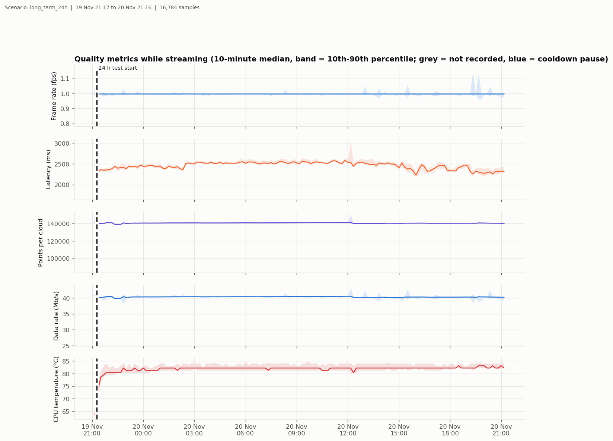
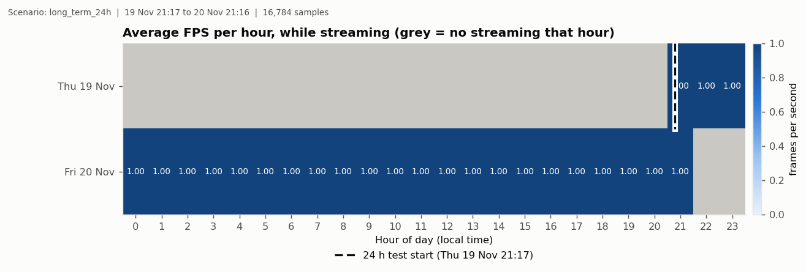
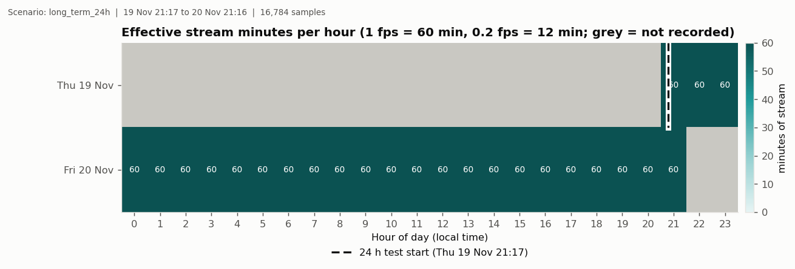

# 24-hour long-term test results

Continuous recording of the sensor computer's point-cloud stream, sampled every 5 s by the
Device Monitor from **Thu 19 Nov 2026 21:17 to Fri 20 Nov 2026 21:16** (Australia/Sydney).
16,784 samples, no recording gaps.

## Key results

| Measure | Result |
|---|---|
| Duration recorded | 24.0 h (no gaps) |
| Time streaming | **100.0 %** |
| Continuous runs | 1 run of 24.0 h |
| Breaks / reconnects | **0 / 0** |
| Frame rate while streaming | 1.00 fps |
| Effective stream time | 59.99 min per hour |
| Data rate | 40.4 Mb/s |
| Points per cloud | about 140,500 |
| Latency (median) | about 2,490 ms |
| CPU temperature | 82.2 °C mean, 85.9 °C maximum |

The stream stayed up for the whole 24 hours with no drops, no restarts and no change in frame rate,
point count or data rate. The CPU temperature settled at about 82 °C within the first hours and stayed there.

## Plots

**Quality metrics over time** (frame rate, latency, points per cloud, data rate, CPU temperature):

**Timeline** (green = streaming, one row per day):

**Hourly heatmaps**

Availability (% of each hour streaming):

Frame rate (fps):

Data rate (Mb/s):

Effective stream minutes per hour (1 fps = 60 min):

## Data

- [data/hourly.csv](data/hourly.csv): one row per hour (availability, fps, data rate, latency, temperature)
- [data/summary.json](data/summary.json): headline numbers

## Definitions

- **Streaming**: the device is publishing point clouds and the monitor receives them.
- **Effective stream minutes**: frames received divided by 1 fps, scaled to a 60-minute hour
  (0.2 fps counts as 12 min).
