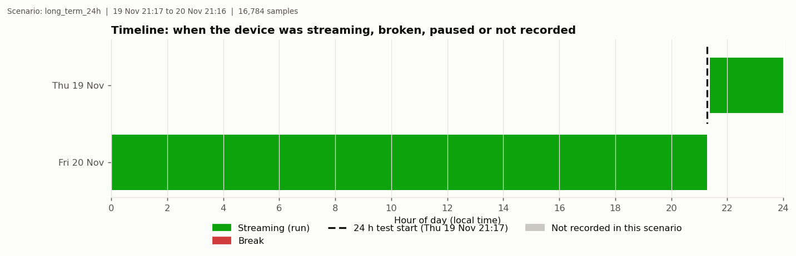
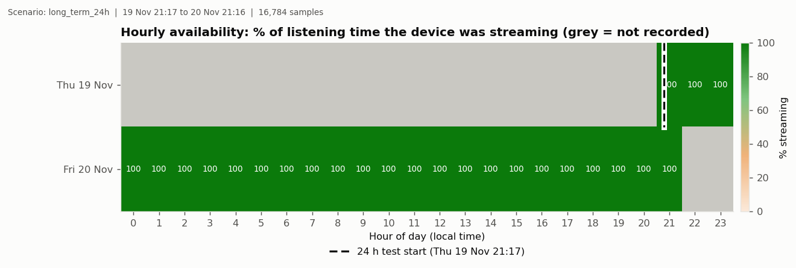
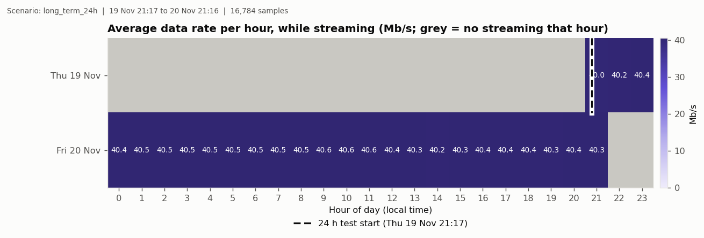

# 24-hour long-term test results

Continuous recording of the sensor computer's point-cloud stream, sampled every 5 s by the
Device Monitor from **Thu 19 Nov 2026 21:17 to Fri 20 Nov 2026 21:16** (Australia/Sydney).
16,784 samples, no recording gaps.

## Key results

| Measure | Result |
|---|---|
| Duration recorded | 24.0 h (no gaps) |
| Time streaming | **100.0 %** |
| Continuous runs | 1 run of 24.0 h |
| Breaks / reconnects | **0 / 0** |
| Data rate | 40.4 Mb/s |
| Points per cloud | about 140,500 |

The monitor recorded continuous streaming throughout the 24-hour test, with
no breaks or reconnects.

## Plots

**Timeline** (green = streaming, one row per day):

**Hourly heatmaps**

Availability (% of each hour streaming):

Data rate (Mb/s):

## Data

- [Hourly test data](data/hourly.csv)
- [Capture summary](data/summary.json)
- [Diagnostic plots](plots/)

## Definitions

- **Streaming**: the device is publishing point clouds and the monitor receives them.
